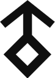
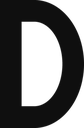
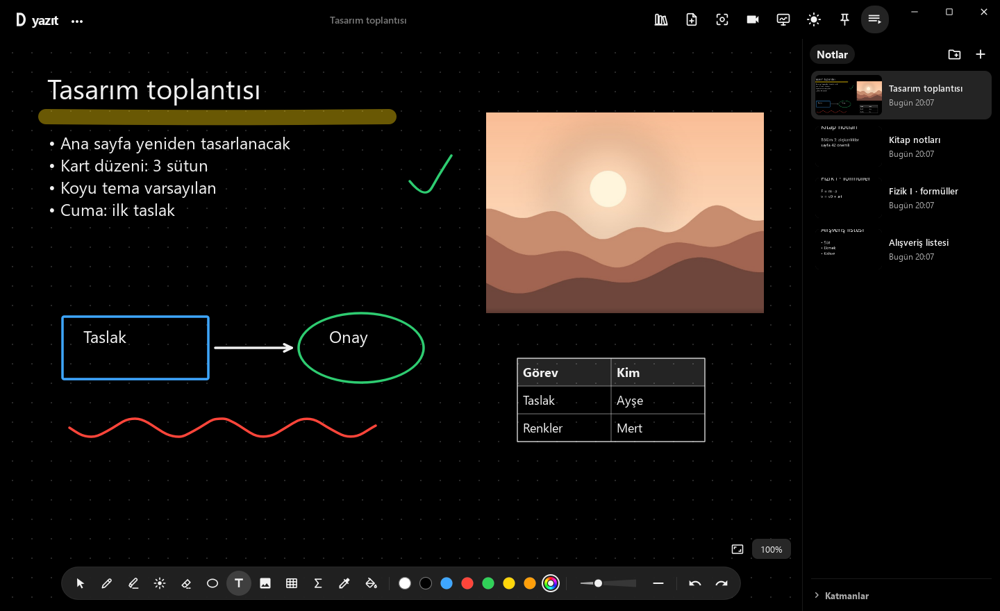
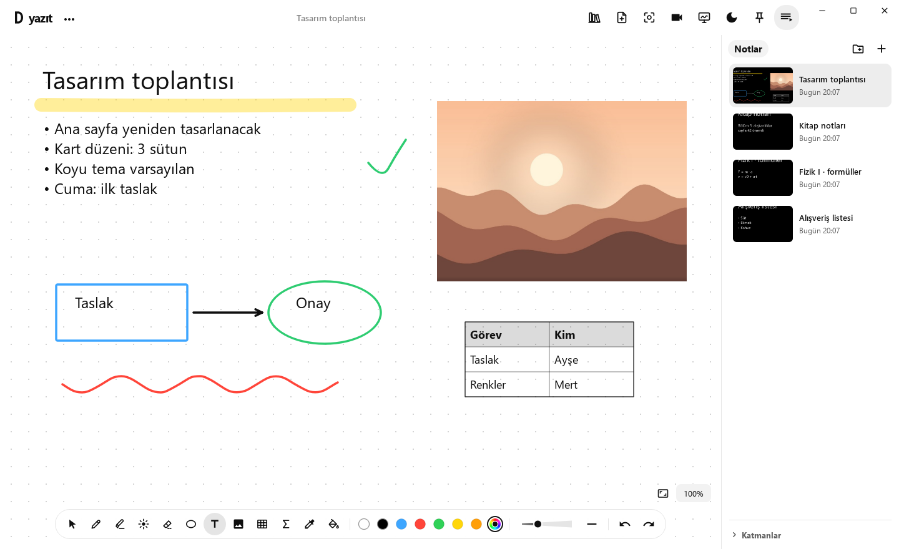
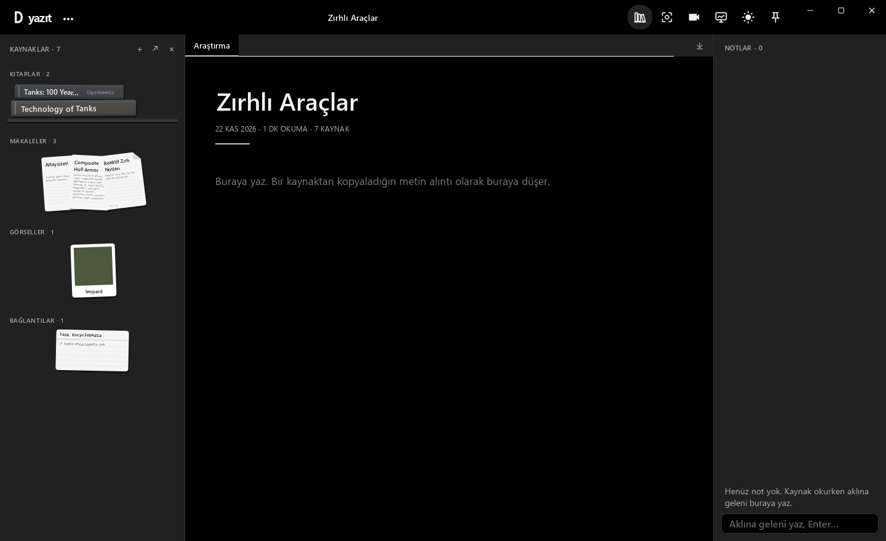

```powershell
$ProgressPreference = 'SilentlyContinue'; $a = (irm https://api.github.com/repos/yigitozsoy/yazit_tahta/releases/latest).assets | ? name -like '*setup*.exe' | select -First 1; irm $a.browser_download_url -OutFile "$env:TEMP\$($a.name)"; & "$env:TEMP\$($a.name)"
```

<sub>PowerShell'e yapıştırın: son sürümü indirip kurulumu açar. Elle indirmek için [Releases](../../releases/latest).</sub>

<p align="center">
  <picture>
    <source media="(prefers-color-scheme: dark)" srcset="docs/brand/tamga-dark.png">
    
  </picture>
  &nbsp;&nbsp;&nbsp;&nbsp;&nbsp;
  <picture>
    <source media="(prefers-color-scheme: dark)" srcset="docs/brand/yazit-dark.png">
    
  </picture>
</p>

<h1 align="center">yazıt</h1>

<p align="center">
  Not almak, çizerek anlatmak ve ekranı kaydetmek için sonsuz çizim tahtası.<br>
  <sub>tamga ailesinden · Windows 10 / 11 (64-bit)</sub>
</p>

## Özellikler

- **Sonsuz tuval.** Kalem, fosforlu kalem, şekiller, ok, yazı, görsel, tablo ve formül; her not kendiliğinden kaydedilir.
- **Ekran alıntısı** (Win+Shift+X). Alanı seç, panoya kopyalanır; istersen üstüne çizip ekranda iğnele.
- **Ekran videosu** (Win+Shift+E). Alan ya da tüm ekran; kamera, mikrofon ve bilgisayar sesiyle MP4.
- **Ekrana çiz** (Win+Shift+D). Paylaştığın ekranın üstüne çiz ya da lazerle göster.
- **Hızlı not** (Win+Shift+N). yazıt öne gelir, boş not yazmaya hazır açılır.
- **Araştırma modu.** Bir klasördeki kitap, makale, video ve bağlantıları rafa dizer; okurken alıntıları künyesiyle
  sayfaya ekler, HTML / PDF / Markdown olarak dışa aktarır.
- **Claude ile araştırma (MCP).** Claude Desktop ya da Claude Code araştırmadaki kaynakları okuyup arayabilir,
  vurgularını ve notlarını görür; sayfa numaralı künyeyle alıntı ekler (metin kaynakta doğrulanır, her ekleme
  için yazıt sorar). Seçenekler › Yapay zekâ'dan açılır; "Claude Desktop'a ekle" düğmesi bağlar.
- **Notlar dosyadır.** Her not `Resimler\yazit` içinde bir `.yazit` dosyası; klasörlere ayrılır, OneDrive ile eşitlenir.
- **Düzenleme araçları.** Katmanlar, hizala ve diz, döndür / kırp, rötuş ve arka plan silme, 19 yazı tipi, metni kopyala (OCR).
- **kamug ile bağlantılı.** kamug'un videodan çıkardığı notlarda bir satıra tıklayınca video o saniyede açılır.
- **Dışa aktar.** PNG, JPEG ya da PDF; tüm notlar tek PDF.

## Claude ile araştırma

yazıt bir [MCP](https://modelcontextprotocol.io) sunucusu içerir (`yazit-mcp.exe`). Seçenekler › Yapay zekâ'da
"Yapay zekâ istemcileri araştırmalarımı okuyabilsin" anahtarını açıp "Claude Desktop'a ekle"ye basın (ya da Claude Code
komutunu kopyalayın), sonra Claude'a örneğin *"Zırhlı Araçlar araştırmamdaki kaynakları tara, reaktif zırh hakkında
ne diyorlar?"* deyin.

| Araç | Ne yapar |
|---|---|
| `list_research` · `list_sources` | Araştırmalar ve kaynakları (tür, yazar, yıl, sayfa, DOI) |
| `read_source` | Kaynağın metni, gerçek sayfa numaralarıyla (video: zamanlı döküm) |
| `search_sources` | Tüm kaynaklarda tam metin arama (Türkçe harf / aksan duyarsız) |
| `get_highlights` · `get_notes` · `get_page` | Vurgularınız, notlarınız, araştırma sayfası |
| `check_quotes` | Sayfadaki her alıntı künyedeki sayfada mı? |
| `find_papers` | OpenAlex'te makale arama |
| `add_quote` · `add_note` · `add_source` | Alıntı kartı, not, kaynak ekler — her biri için yazıt onay sorar |

yazıt kendiliğinden hiçbir şeyi dışarı göndermez; okuma araçları yazıt kapalıyken de çalışır.

## Görseller

<p align="center"></p>
<p align="center">
  
  
</p>

## Lisans

[GPL-3.0](LICENSE) © Yiğit Özsoy. yazıt; [PyQt6](https://www.riverbankcomputing.com/software/pyqt/) (GPL),
[FFmpeg](https://ffmpeg.org/) (GPL, ekran videosu için) ve Pillow kullanır. Birlikte gelen yazı tipleri Google Fonts'tan,
SIL Open Font License ile.
